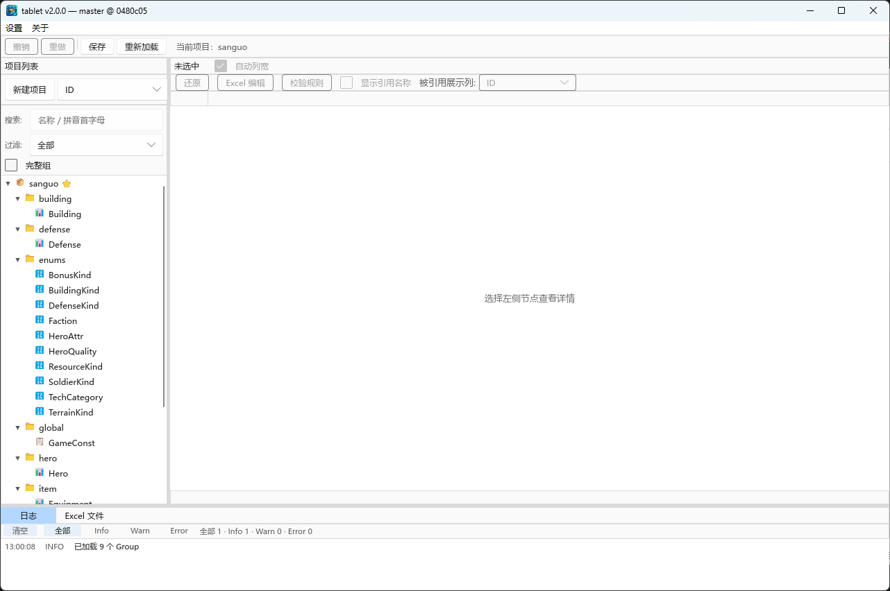

# tablet

**把游戏配置表从「一堆 Excel 附件」变成可 review、可验证、可生成代码的工程资产。**

策划照常在表格里填数据，程序拿到的是类型安全的代码：数据以 `.tbl` 纯文本进入 Git，Excel 只当编辑器；一条命令同时产出 JSON / XML 和 10 份多语言配置代码。

- **`tablet`**：桌面端（Slint）。双击 / 零参数走 GUI，其它参数自动转给 CLI——部署只需要一个 exe。
- **`tablet-cli`**：命令行入口，给 Jenkins / CI / 自动化脚本用，与 GUI 共享同一份 core。
- 支持多 Project、模板建项、Excel 双向桥接、任意 Excel 映射导入，以及 `.tbl` / `.xlsx` 两种存储后端。



## 它解决什么问题

| 常见痛点 | tablet 的做法 |
|---|---|
| 配置散落在 Excel 里，diff / review / 合并都痛苦 | `.tbl` 一行一记录，纯文本进 Git，自动 merge |
| 表改了，代码没跟上 | 一套 schema 同时生成数据 + 10 份代码，CI 一键跑 |
| 上线前才发现配置填错 | 节点级校验规则 + 分级策略，保存前拦截 |
| 策划不愿换工具、存量 Excel 搬不动 | Excel 式编辑、外部 Excel 桥接、任意 Excel 映射导入；也可以整组直接读写 `.xlsx` |
| 测试 / 正式 / 多渠道配置混在一起 | 多 Project 隔离，各自导出、各自配置 |
| 保存一次满屏文件时间都变了 | 只写真正变了的文件；读不懂的文件直接报错，不静默兜底 |

## 适合谁

- **策划 / 数值**：在 Excel 风格的表格里编辑，四行表头（描述 / 导出端 / 类型 / 字段名）、复制粘贴、列宽自适应、Ctrl+Z 连续撤销。
- **程序**：一份 schema 生成服务端 + 客户端代码，业务扩展区间在重新导出时保留；生成代码有编译级 e2e 兜底。
- **技术负责人 / CI**：`.tbl` 可 diff、可 review；CLI 把「验证 → 导出」串进流水线；工作区锁保证 GUI 与 CI 不会同时写。

## 核心能力

| 能力 | 说明 |
|---|---|
| **表格编辑** | Excel 式选区 / 编辑 / 剪贴板互通；7 种基础类型 + 14 种复合范式（List / Set / Map / Tuple2–4 / `@Ref` ...） |
| **Excel 双向** | 调起外部 Excel / WPS 编辑后自动回写；底部「Excel 文件」面板做逐表同步；任意布局的 Excel 可映射导入（选表头 / 数据区 / id 列 + 列映射，多 Sheet 独立处理） |
| **两种存储后端** | 默认 `.tbl` 目录（文本、可 diff）；也可整组用一个 `.xlsx`（节点 = sheet），直接接管存量 Excel |
| **校验** | 内置校验 + 节点级 `# @rule`；错误 / 警告 / 提示三级，按项目策略决定阻断保存、仅提示还是忽略 |
| **多语言导出** | JSON / XML + Java / Go / C++ / C#（.NET / Unity / Godot）/ TypeScript（服务端 / 客户端）/ Lua / GDScript，共 12 种格式 |
| **多项目** | 同一仓库并存 `projects/<id>/`（如 slg-test / slg-prod），树上一键切换，互不影响 |
| **可靠保存** | 编辑在内存、按「保存」落盘；只写真正变了的文件；工作区进程锁 + 工作簿外部改动检测 |
| **AI / 自动化** | 随仓库分发 `skills/tablet`，AI 助手可独立完成「建项目 → 验证 → 导出」 |

## 典型工作流

```text
策划：
  打开 tablet → 左侧树选表 → 直接编辑 / 「Excel 编辑」
      → 校验通过 → 保存 → .tbl（或 .xlsx）更新 → git commit / push

程序 / CI：
  git pull → tablet-cli validate → tablet-cli export all
      → 生成 server/data + server/code + client → 编译运行
```

## v2.0.0 亮点

- **任意 Excel 映射导入**：不必先改造成 tablet 格式——选表头行、数据区、id 列，把源列映射到字段，自动规范化命名、推断类型、补齐四行表头；多 Sheet 各自独立映射。
- **工作簿组**：一组一个 `.xlsx`，节点 = sheet；结构与数据都以工作簿为准，适合接管存量 Excel。
- **节点级校验规则**：`# @rule` 写规则，错误 / 警告 / 提示按项目策略决定是否阻断保存。
- **按项目保存 + 连续撤销/重做 + 还原**：撤销历史按 Project 隔离；单个节点和项目设置都能「还原到已保存」。
- **生成代码能力对齐**：字段注释、枚举反查、命名转换与撞名检测在 7 个后端拉平；业务扩展保留区间默认开启；Java 可选 Lombok `@Getter`。
- **保存行为可预期**：只重写内容真的变了的文件；解析失败带行号 / 列 / 字段报错；GUI 与 CLI 通过工作区锁互斥。
- **体验补强**：日志分级与过滤、列宽自适应 / 手动、工作区分支与提交号展示。

## GUI 一览

- **左侧项目树**：多 Project、新建项目（模板 / 文件 / 空白）、按 ID / 名称 / 创建时间排序、拼音首字母搜索、按状态过滤（全部 / 改动 / 新增 / 修改 / 删除）。
- **中间表格**：四行表头（描述 / 导出端 / 类型 / 字段名）；「还原」「Excel 编辑」「校验规则」「显示引用名称」「被引用展示列」都在功能条上。
- **顶部工具栏**：撤销 / 重做 / 保存 / 重新加载；标题栏显示版本、分支与提交号。
- **底部面板**：日志（Info / Warn / Error 分级过滤）与 Excel 文件同步两个 tab。

完整的右键菜单和交互细节见 [docs/04-UI设计.md](docs/04-UI设计.md)。

## CLI

```text
$ tablet-cli --help
tablet-cli v2.0.0 — TBL 配置管理工具（命令行模式）

Usage: tablet-cli [OPTIONS] <COMMAND>

Commands:
  project         项目管理
  schema          结构操作
  export          导出数据/代码
  validate        验证 .tbl 文件（支持五级粒度过滤）
  excel           Excel 桥接
  workspace       工作区操作
  sep             分隔符查询
  util            底层工具（无需项目上下文）
  list-templates  列出可用模板
```

| 命令组 | 用途 |
|---|---|
| `project list/info/new/clone/rename/delete` | 多项目管理 |
| `project import-tbl/import-xlsx` | 原生导入存量 `.tbl` / Excel 工作簿 |
| `schema show/add-*/rename-*/delete-*` | 项目结构增删改查 |
| `export data --json/--xml` | 数据导出（可按 group / node 过滤） |
| `export code --java/--go/...` | 代码导出（可覆盖 package / namespace） |
| `export all` | 全量导出 |
| `validate [--group/--node/--col/--row]` | 五级粒度验证 |
| `excel export/import` | Excel 桥接 |
| `workspace save/reload/clear/info` | 工作区状态与分支信息 |
| `util parse-*/validate-*/diff/fmt/stat/...` | 无上下文的单文件工具 |

```bash
# 典型 CI 流水线
tablet-cli --project slg-prod validate || exit 1
tablet-cli --project slg-prod export all
```

完整子命令与退出码约定见 [docs/03-CLI工程.md](docs/03-CLI工程.md)。

## 仓库里长什么样

```text
<repo>/
├── tablet.toml                 工作区配置（全局默认 + 上次打开的项目）
└── projects/<id>/
    ├── project.tblmanifest     项目身份 + 节点索引 + 规则 / display
    ├── project.toml            项目配置（[export] / [validate]）
    └── config/
        ├── <group>/<Name>.tbl  .tbl 组：结构与数据的真相源
        └── <group>.xlsx        工作簿组：一个文件，sheet = 节点
```

`.tbl`、`.tblschema`、`project.tblmanifest`、`project.toml` 都应进版本控制；`.tbl-cache/` 与 `.data/` 是工具临时物。

## 下载与构建

预编译包（Windows / Linux / macOS）见 [Releases](https://github.com/juebanlin/tablet/releases)。

```bash
# 开发：dev profile（编译速度优先）
cargo build -p tablet-slint     # GUI 二进制 → target/debug/tablet[.exe]
cargo build -p tablet-cli       # CLI 二进制 → target/debug/tablet-cli[.exe]

# 发布：按宿主跑
bash scripts/release.sh host
```

详细发布矩阵与平台兼容性见 [docs/09-平台发布.md](docs/09-平台发布.md)。

## 文档与 AI 技能

完整设计与使用文档在 [`docs/`](docs/)，建议从 [00-概述](docs/00-概述.md) 开始：

- [01-tbl 系统](docs/01-tbl系统.md) — `.tbl` / `.tblschema` 文件格式与硬性规则
- [02-核心功能](docs/02-核心功能.md) — Project / 模板 / 导出 / 验证 / 存储布局
- [03-CLI 工程](docs/03-CLI工程.md) — 源码分层、仓库布局、子命令与退出码
- [04-UI 设计](docs/04-UI设计.md) — GUI 交互与右键菜单
- [06-Excel 桥接](docs/06-Excel桥接.md) / [14-Excel 映射导入](docs/14-Excel映射导入.md)
- [11-生成代码特性对照](docs/11-生成代码特性对照.md) — 各语言产物的能力矩阵
- [12-保存与连续撤销](docs/12-保存与连续撤销.md) — 保存语义与撤销模型

[`skills/tablet/`](skills/tablet/) 是可直接分发的 AI 技能包：拷贝到项目的 `.claude/skills/`，AI 助手就能读写配置表并跑完整流水线。

## 授权

本项目按 crate 分别授权，详见 [LICENSE.md](LICENSE.md)：

| Crate | License |
|---|---|
| `tablet-core` / `tablet-cli` | [Apache-2.0](LICENSE-APACHE) |
| `tablet-slint`（GUI） | [GPL-3.0-only](LICENSE-GPL) |

GUI 静态链 [Slint](https://slint.dev/) 的 GPLv3 一支，因此 GUI 整体受 GPLv3 覆盖。**用 GUI 编辑产生的 `.tbl` 数据文件不是 GUI 的衍生作品**——和 Blender / GIMP 一样，工作流产物归用户所有，GPL 不传染。
